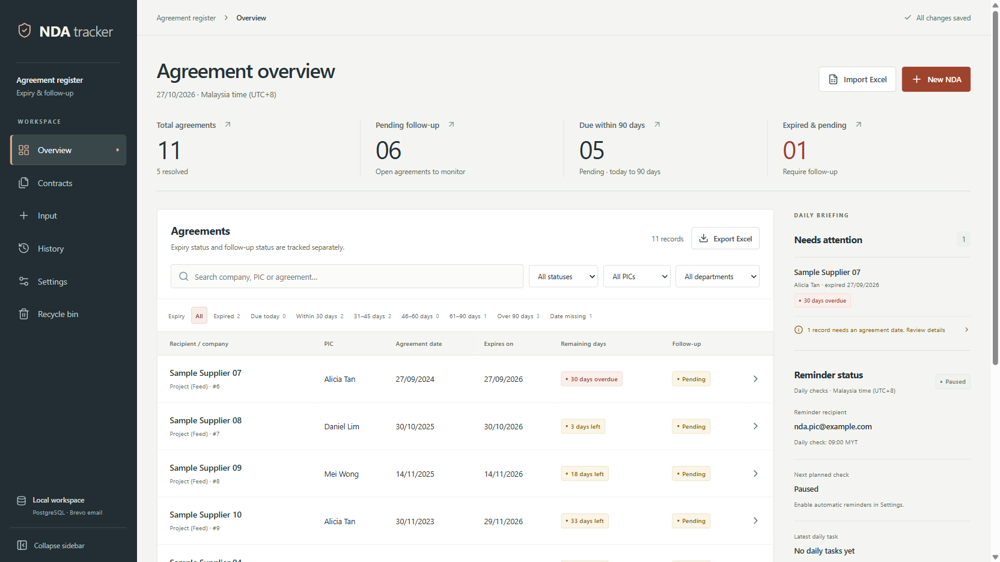
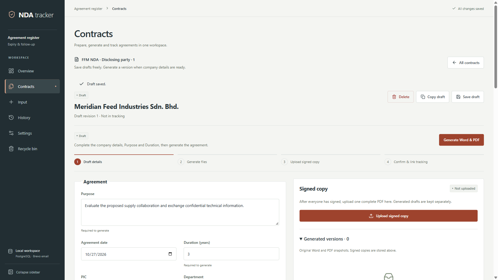
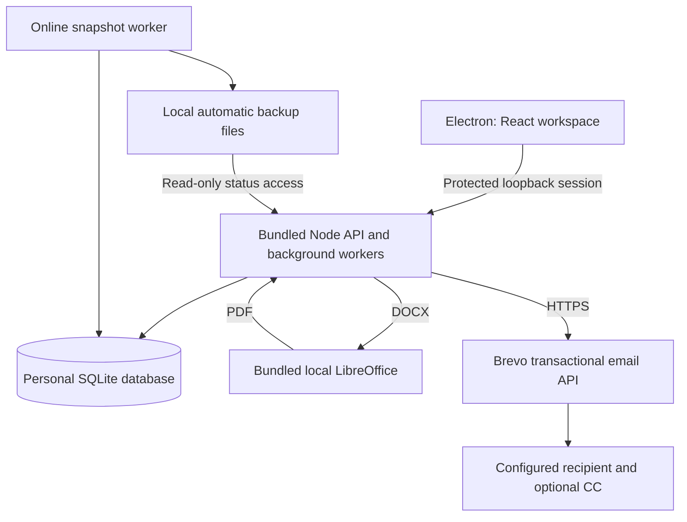

<p align="center">
  
</p>

<h1 align="center">NDA Tracker</h1>

<p align="center">
  A contract preparation and NDA tracking workspace for generating agreements, keeping signed copies, monitoring expiry, and sending daily email reminders.
</p>

<p align="center">
  
  
  
  
</p>

<p align="center">
  <a href="#quick-start">Quick Start</a> ·
  <a href="#workspace-preview">Preview</a> ·
  <a href="docs/USER_GUIDE.zh-CN.md">中文使用说明</a> ·
  <a href="docs/DEVELOPMENT.md">Developer Guide</a> ·
  <a href="docs/API.md">API Reference</a>
</p>

## Why This Project Exists

**Desktop edition:** this source revision targets a standalone Windows x64 installer with a bundled runtime, per-user SQLite database and local PDF conversion. Users download the installer from GitHub Releases rather than cloning the repository or installing Docker. See the [Windows installation and recovery guide](docs/WINDOWS_DESKTOP.md).

The previous PostgreSQL/Docker edition is preserved at commit [`f51e672`](https://github.com/shiebin-bit/nda-tracking-dashboard/commit/f51e672). Docker commands in older guides apply to that version. Do not rebuild an existing PostgreSQL deployment from this desktop source before migrating its data.

Preparing an NDA and following it up often involves an Excel register, a Word template, a folder of signed PDFs, and a separate reminder flow. NDA Tracker brings those steps into one local workspace.

Users select an NDA or EOI template, prepare documents, generate files and keep the final signed PDF. Confirming an NDA starts or links expiry tracking; confirming an EOI stores its signing status independently. Supplier IDs and projects connect related documents. The backend checks NDA expiry dates and sends a daily digest through Brevo to the configured recipient, including Outlook or university mailboxes. Power Automate and Microsoft Entra registration are not required for this email path.

## What It Covers

- Agreement overview with expiry counts, follow-up status, search, PIC and department filters, and pagination
- Contracts workspace with draft editing, copying, workflow stages, and a suggested next action
- Versioned FFM NDA generation as Word and PDF
- Separate storage for generated files and final signed PDF copies
- Per-contract signed-copy upload, replacement history, preview, download, and print
- Manual signing confirmation that links or creates a tracking record without duplicate registration
- Excel register import with row validation, duplicate detection, and review before saving
- Excel export of all agreements or all filtered matches across pages, preserving the original 26 columns
- Excel contract-draft import and batch generation of up to 100 agreements with progress and ZIP output
- Editable reminder milestones, exact-day alerts, and daily reminders for expired Pending agreements
- Brevo connection checks, explicit test emails, reminder previews, delivery records, and failure handling
- Agreement history, append-only follow-up notes, renewal links, and optimistic version checks
- Recoverable deletion for agreements and contracts
- Personal SQLite persistence, register-only JSON recovery, and automatic complete database snapshots
- Windows desktop installer with bundled PDF conversion, system tray operation and optional Windows startup
- Stable website references for agreements (`AGR-000001`) and documents (`DOC-000001`), including existing records
- Supplier IDs and shared projects, with explicit assignment of existing agreements/documents and review of linked groups
- Versioned template drafts: DOCX paragraph/cell editing and fixed-layout PDF field placement
- Up to ten CC recipients for the daily reminder digest

## Workspace Snapshot

| Workspace | Main responsibility |
| --- | --- |
| **Overview** | Find agreements needing attention; search, filter, export Excel, and inspect reminder status |
| **Documents** | Choose a template through New document, prepare drafts, keep signed copies, and confirm NDAs into tracking |
| **Suppliers** | Maintain internal supplier codes and shared projects; find linked agreements and project documents |
| **Templates** | Import DOCX/PDF, edit text or field positions, preview and publish immutable versions |
| **Input** | Register, edit, and renew tracking records using the original Excel fields |
| **History** | Review record changes, imports, renewals, notes, settings changes, and recovery activity |
| **Settings** | Configure reminder recipients, CC, check time, milestone days, email delivery, and backups |
| **Recycle bin** | Restore deleted agreements or contracts while retaining their history and files |

## Workspace Preview

These screenshots use an isolated demonstration dataset captured on 27 October 2026. Reminder sending was disabled in that copy. They are illustrative screens, not a live view of the current database.

### Agreement overview



### Contract preparation



### Batch generation


## Agreement Workflow

```mermaid
flowchart LR
    T[New document: choose a published template] --> A[Enter details or import Excel drafts]
    A --> B[Save draft]
    B --> C[Generate Word and PDF]
    C --> D[Review, download or print]
    D --> E[Collect signatures outside the system]
    E --> F[Upload complete signed PDF]
    F --> G[Review and confirm signed]
    G --> H[Link or create Pending tracking record]
    H --> I[Monitor expiry and follow up]
    I --> J[Resolve or renew]
```



### Drafts, versions and signed copies

- FFM company, contact, signatory and witness defaults are editable for each draft. Client details start empty.
- Drafts can be incomplete. Generation requires both companies' names, registration numbers and addresses, a Purpose, and a valid Duration. Unknown personnel and dates can stay blank at generation time.
- Each generation preserves its values and document version. Changing a draft does not rewrite previously generated files.
- A signed-copy upload accepts one complete PDF of up to **20 MiB**, associated with a complete generated version. Uploading alone leaves the contract as Draft.
- New signing confirmations require the current signed file, agreement date and PIC. Confirmation creates or links the tracking record transactionally. Repeated confirmation requests do not create duplicate tracking records.
- Existing Signed agreements without an attached file show **Signed · File missing**. A later attachment does not create another tracking record.
- Replacing a signed copy preserves the previous upload. It does not change the tracking dates, Duration or follow-up status.
- When a draft is linked to an existing record and values differ, the user must resolve the difference explicitly. The system does not silently overwrite the record or reopen a Resolved agreement.

Signatures are checked by the user. The application does not provide electronic signing, recognize signature fields, or verify signature authenticity. Word edits made after downloading do not synchronize back to the website.

## Reminder Rules

| Rule | Current behavior |
| --- | --- |
| Time zone | `Asia/Kuala_Lumpur` (UTC+8) |
| Default daily check | **09:00 MYT**, configurable in Settings |
| Default milestones | **90, 60, 45, 30** days before expiry, configurable positive distinct integers |
| Eligible records | Active **Pending** records at an exact milestone, or with fewer than 0 days remaining |
| Expired Pending | Included in the daily digest until resolved or recycled |
| Resolved | Excluded from reminders |
| Due today (0 days) | Displayed as Due today; not an email candidate under the current rule |
| Missing or invalid date/Duration | Excluded until corrected |
| Empty candidate list | Recorded as No reminders due; no email is sent |
| Restart after the scheduled time | Processes today's unhandled task; does not replay past dates |

The worker checks on startup and every minute. SQLite stores the daily task and delivery history with a unique local-date constraint to guard against duplicate daily submission. Explicit failures can be retried through Settings; uncertain results caused by timeouts or interruption are marked **Needs review** and are not automatically resent.

**Submitted** means Brevo accepted the request. Actual delivery must be checked in the mailbox or Brevo logs. Test emails have a `[TEST]` subject, contain example content, omit CC, and do not consume the daily reminder task.

The window can be closed while reminders continue in the system tray. **The computer and NDA Tracker must remain running.** Quit from the tray to stop the background service. Sending email requires internet access; local editing and PDF generation do not.

### Date calculation

The current register preserves the original spreadsheet convention:

```text
durationDays   = trunc(Duration × 365)
expiryDate     = agreementDate + durationDays
remainingDays  = expiryDate - today's Malaysia date
```

This supports positive fractional years. It is a fixed-day rule, not a calendar-year anniversary calculation. Remaining days are derived from the current date; no daily counter needs to be manually updated. Excel export writes a fixed snapshot for the export day.

## Stack

### Frontend

- React 19 and TypeScript 5.9
- Vite 8
- Lucide icons and responsive CSS
- ExcelJS for workbook import/export
- Browser-native PDF preview and printing

### Backend

- Electron 45 with bundled Node.js 24 runtime and TypeScript
- Native Node HTTP server
- SQLite through `node:sqlite`; PostgreSQL is a one-time migration source only
- Docxtemplater and PizZip for DOCX generation
- Busboy for signed-PDF multipart uploads
- Yazl for streaming batch ZIP downloads
- Brevo transactional email API

### Infrastructure and verification

- Per-user NSIS Windows installer with explicit resource allowlists
- Bundled LibreOffice and app-local Microsoft runtime for DOCX-to-PDF conversion
- Windows-provided Times New Roman fonts; Microsoft fonts are not redistributed
- Verified SQLite online snapshots and complete workspace restore
- Vitest unit and SQLite integration tests
- GitHub Actions checks and a manually triggered Windows installer build

## Architecture



The application owns the record APIs, document job worker and email scheduler. SQLite holds agreements, history, templates, contract snapshots, generated DOCX/PDF binaries, uploaded signed PDFs and mail records. Conversion uses an isolated local LibreOffice profile. The converter does not inherit the email credential or desktop session token.

Each Windows user/computer owns an independent workspace under `%LOCALAPPDATA%\NDA Tracker`. The desktop API binds only to loopback on a random port and requires the desktop session cookie. There is no shared account system; activity attribution remains **Local user**. This is a personal desktop application, not a public or multi-user server.

Repository layout:

```text
nda-tracking-dashboard/
├── .github/workflows/     # CI tests and Windows installer build
├── docs/                 # Guides, architecture, API and demo screenshots
├── migrations/           # Ordered, incremental PostgreSQL migrations
├── scripts/              # Windows startup, backups and template preparation
├── server/               # HTTP API, stores, document/email/backup workers
├── src/                  # React UI, shared types, rules and Excel handling
├── templates/            # Fixed versioned FFM DOCX and integrity metadata
├── tests/fixtures/       # Anonymized legacy-workbook compatibility cases
├── .env.example          # Configuration names with no real credentials
├── compose.yaml
├── Dockerfile
├── Dockerfile.backup
└── package.json
```

## Current State

The desktop port preserves contract preparation, document generation, final-PDF storage, manual signing confirmation, NDA tracking, reminders, history and recovery. Installer verification results are recorded separately from the earlier Docker rollout.

Fresh installations create an **empty register** and seed the FFM NDA and EOI templates. The repository does not recreate the original Excel records or import demonstration data on startup. Test fixtures are not runtime seeds.

Current limits:

- DOCX editing preserves document structure; arbitrary Word layout editing and OCR are not included
- Manual signature confirmation; no electronic signature service
- One configured recipient and up to ten optional CC addresses per digest
- Local trusted access with no accounts or individual user attribution
- The desktop installer targets Windows x64; other platforms are not packaged
- Local backups need separate off-device protection
- No cloud deployment or public URL is supplied by this repository

## Quick Start

1. Download the Windows x64 installer from the [v0.2.0-beta.1 preview release](https://github.com/shiebin-bit/nda-tracking-dashboard/releases/tag/v0.2.0-beta.1). The runtime and PDF converter are included; no separate dependency installation is needed. This preview is unsigned; company application policies may require IT approval.
2. Install and open **NDA Tracker**. No separate Docker, Node.js or database installation is needed.
3. Add suppliers/projects and documents, or import Excel. A fresh installation starts empty.
4. In **Settings → Desktop workspace**, configure your own Brevo connection and optional Windows startup.
5. Save reminder recipients/rules and enable automatic reminders when ready.

The complete installer includes the PDF converter. Preview builds are unsigned; company application-control rules may require IT approval. See [Windows installation, upgrade and recovery](docs/WINDOWS_DESKTOP.md) for full instructions.

## Personal Data and Recovery

- The SQLite database is stored separately from application files in `%LOCALAPPDATA%\NDA Tracker`.
- **Save complete backup** includes all documents, signed files, suppliers, templates, History and the mail ledger in one verified `.sqlite` file.
- **Restore complete backup** saves a safety copy and pauses automatic reminders. The Windows-protected email key remains on the current computer.
- Automatic backups run on first start and daily at **02:00 MYT**, retaining 14 successful copies with restart catch-up.
- The original register JSON backup contains the active register, History and reminder preferences only.
- Installing an update preserves personal data. Keep an off-device complete backup too.

<details>
<summary>Legacy Docker reference — applies only to the pre-desktop version at f51e672</summary>

### Legacy setup

### 1. Requirements

- Git and access to this repository
- Windows with Docker Desktop running Linux containers and Docker Compose v2
- Times New Roman at `C:/Windows/Fonts/times.ttf`, `timesbd.ttf`, `timesbi.ttf`, and `timesi.ttf`
- Available local ports **5183** and **5433**
- Internet access for the first image build; a Brevo account/API key only if email is needed

Node.js is optional for Docker-only operation. Development requires Node.js **22.12+** compatible with the locked dependencies.

### 2. Clone and start

```powershell
git clone https://github.com/shiebin-bit/nda-tracking-dashboard.git
cd nda-tracking-dashboard
.\OPEN-NDA-DASHBOARD.cmd
```

On first use, the launcher creates `.env` with a random database password, builds and starts `app`, `db`, `converter`, and `backup`, waits for readiness, then opens the browser. To keep the browser closed:

```powershell
powershell.exe -NoProfile -ExecutionPolicy Bypass -File scripts/Start-Dashboard.ps1 -NoBrowser
```

Open **http://127.0.0.1:5183**. A fresh database has no agreements and automatic email is off. Add tracking records through Input or import Excel; prepare contracts from Contracts.

For manual configuration, copy `.env.example` to `.env`, replace the password placeholder with a long random hexadecimal value, then run:

```powershell
docker compose up -d --build --wait --wait-timeout 180
docker compose ps
```

Do not replace an existing `.env` during an upgrade. Changing `NDA_DB_PASSWORD` in the file does not rotate an initialized PostgreSQL password. See [Operations](docs/OPERATIONS.md) for configuration and recovery.

### 3. Configure email when ready

1. Add `BREVO_API_KEY` to the local `.env`. Keep the database password intact.
2. Recreate the application to load runtime configuration:

   ```powershell
   docker compose up -d --build --wait app
   ```

3. In Settings, check the Brevo connection and save a verified sender.
4. Use an explicit test recipient for a `[TEST]` email, then check its mailbox.
5. Save the real recipient, optional CC, daily check time and reminder milestones.
6. Enable automatic reminders and save preferences.

The NDA **Recipient** field identifies a client company. It is not used as the reminder destination. The reminder mailbox comes from Settings.

### 4. Stop without deleting data

```powershell
.\STOP-NDA-DASHBOARD.cmd
```

This stops the project's containers while retaining the database volume. Do not use `docker compose down -v` for ordinary shutdown; it removes the stored database.

### Optional DataGrip connection

| Setting | Value |
| --- | --- |
| Driver | PostgreSQL |
| Host | `127.0.0.1` |
| Port | `5433` |
| Database | `nda_tracker` |
| User | `nda_app` |
| Password | Local `.env` value of `NDA_DB_PASSWORD` |

## Data, Backups and Recovery

- **Database volume:** `nda_pgdata` under the `nda-tracker` Compose project. Rebuilding the application does not reset records.
- **Automatic complete backup:** first backup on initialization, then daily at **02:00 MYT**, retaining **14 successful automatic backups** in `backups/automatic/`. Failed attempts retry after approximately 15 minutes.
- **Manual complete backup:** run `BACKUP-DATABASE.cmd`; files are saved under `backups/`.
- **Register JSON / Saved versions:** active NDA register, History and reminder settings only. Contracts, signed files and the mail ledger stay independent. Restoring register data pauses automatic reminders.
- **Recycle bin:** agreements and contracts are managed separately. Recycling a contract alone does not stop its linked agreement's reminders. Recycling an agreement excludes it from future checks.

Complete PostgreSQL backups include contracts and binary files. Neither complete database backups nor register JSON contains `.env` or the Brevo API key. Keep runtime configuration separately. For a full recovery, use an isolated empty database and verify the result before reconnecting the application. Detailed procedures are in the [Operations Guide](docs/OPERATIONS.md).

</details>

## Testing

Unit tests and production compilation:

```powershell
npm ci
npm test
npm run build
```

SQLite integration tests use disposable temporary databases:

```powershell
npm run test:integration
```

Do not point tests or an import command at an active desktop data file. The PostgreSQL importer reads a separate source snapshot and writes a new destination; it is not part of ordinary desktop startup.

Coverage includes date/milestone boundaries, Excel safety and duplicate handling, version conflicts, atomic renewal, follow-up notes, email scheduling and uncertain outcomes, document job recovery, signed-file validation and confirmation, and recycle-bin restoration.

Desktop checks on **19 November 2026** passed: **135 unit tests**, **49 SQLite integration tests**, and client/server production compilation. The PostgreSQL engine's three incremental-migration tests were replaced by SQLite lifecycle checks; the remaining application integration suites run against disposable SQLite files with no skipped suites. An isolated PostgreSQL import also preserved generated files, signed PDFs, full CC lists and reference sequence gaps, while pausing reminders only in the destination. No real email was sent.

The packaged desktop app was exercised through NDA/EOI generation, signed-file upload, idempotent confirmation, complete backup/restore and close-to-tray operation. See the [desktop verification record](docs/DESKTOP_VERIFICATION.md) for installer checks and remaining validation limits.

### Dependency status

On **19 November 2026**, `npm audit --omit=dev` reported **zero advisories** for the installed production dependency graph. The build-tool dependency graph has six moderate advisories. Recheck the audit when upgrading dependencies; a passing build is not a security clearance for a public deployment.

## CI

[ci.yml](.github/workflows/ci.yml) runs unit tests, SQLite integration tests and the client/server build for pushes and pull requests targeting `main`. It needs no database service or Brevo credentials. PDF conversion in store integration tests uses a local test service. [windows-desktop.yml](.github/workflows/windows-desktop.yml) is a manual Windows build that prepares the bundled converter, creates the installer and uploads it as a workflow artifact.

The workflow verifies the repository; it does not deploy the dashboard or publish an image.

## Documentation

- [中文使用说明](docs/USER_GUIDE.zh-CN.md)
- [Operations and Troubleshooting](docs/OPERATIONS.md)
- [Developer Setup and Verification](docs/DEVELOPMENT.md)
- [Architecture and Data Boundaries](docs/ARCHITECTURE.md)
- [HTTP API Reference](docs/API.md)
- [Template Preparation and Integrity](templates/README.md)
- [Suppliers, Projects, EOI and Template Editing](docs/SUPPLIERS_AND_TEMPLATES.md)

## Repository Notes

- Real `.env` values, database exports, runtime records, signed agreements, generated files, local recordings, browser traces, and dependency/build directories are excluded from Git.
- The included compatibility fixture is anonymized and is loaded by tests only.
- The FFM template and editable company defaults are project-specific materials. No open-source license is supplied for this repository.
- Screenshots use demonstration records. A paused or unconfigured email connection in those images describes the isolated demo, not an email delivery result.
- Before sharing diagnostic logs, remove credentials, email addresses, client information and contract content.
